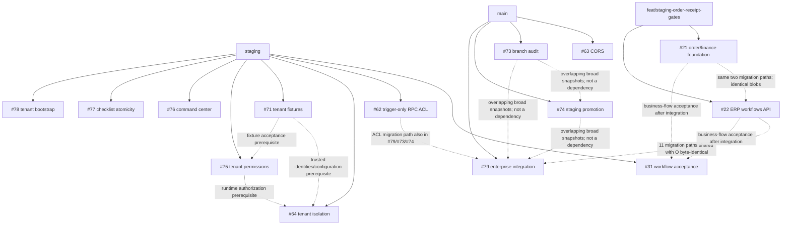

# D’Lice PR dependency and reconciliation graph

**Snapshot:** 2026-11-17 UTC
**Source:** GitHub PR base/head metadata and changed-file lists for PRs #79, #74,
#73, #75, #76, #77, #78, #71, #64, #62, #63, #31, #22, and #21.

## Graph

Solid arrows are the PRs' actual GitHub base branch relationships. Dotted arrows
are validation/overlap observations or a proposed sequencing relationship; they
are not GitHub-declared stacked PR dependencies. A shared file or migration path
does not, by itself, prove one PR depends on another.

## Observed base/head relationships

| PRs | GitHub base branch | Base SHA condition | Relationship |
|---|---|---|---|
| #79, #73, #74, #63 | `main` | #79/#73/#74 target the same reported main SHA; #63 is independently based there | #79/#73/#74 are broad overlapping change sets; #63 is a separate one-file CORS change |
| #75, #76, #77, #78 | `staging` | Same reported staging SHA | Separate PRs; no stacked base relationship established |
| #71, #64, #62, #31 | `staging` | Each has a different, older base SHA than the #75/#76/#77/#78 group | Refresh/recheck base before final review; do not assume mergeability implies current staging validation |
| #21, #22 | `feat/staging-order-receipt-gates` | Same reported base SHA | Sibling PRs, not an ordered GitHub stack; two migration paths overlap and are byte-identical |

The base/head commit SHAs and complete PR statistics are recorded in
[PR_RECONCILIATION_MASTER.md](./PR_RECONCILIATION_MASTER.md).

Phase 2 refreshed the target refs: `main` is
`8d74dbda81eb483a26d779b782fd4b37e12af770`; `staging` is
`aed2733f62506ed87a5040a48f479753fdafe1b1`. Candidate commits below are in
isolated local worktrees only. They are not pushed, merged, or reflected in
GitHub PR head SHAs.

## Proposed work order

This sequence is a review/reconciliation order, not merge authorization.

| Order | Work | Prerequisite / gate | Merge risk if skipped |
|---|---|---|---|
| 1 | Preserve current checkout changes; use isolated candidate worktrees and verify live refs | Current checkout is dirty; target refs and prioritized PR base/head SHAs have been refreshed | Losing local work or reconciling against stale heads |
| 2 | Review #63 independently | Verify current head checks and actual CORS handler behavior; obtain required approval/ruleset evidence | CORS can be mistaken for endpoint authorization; required reviewers are not visible through current integration permissions |
| 3 | Review isolated #75 active-membership candidate | Focused permission/gate contracts and repository checks pass; Deno unavailable; independent review still required | Tenant permission widening or untested code reaching staging |
| 4 | Review #62 local five-path conflict candidate | Conflict-free against current staging and E2E scripts parse; PR base SHA remains stale; migration history unverified | Duplicate/weakened acceptance checks or reapplying a migration already reported applied |
| 5 | Review #77/#76; complete #78 atomic bootstrap validation | Node contracts pass; #78 now provisions local Auth fixtures through Auth Admin, but disposable DB replay is blocked | UI/API could expose unauthorized data or atomic behavior could fail |
| 6 | Verify #71 trusted fixture configuration | Workflow dispatch restricted to trusted staging push; real staging identities/credentials remain unverified and `auth-negative` still fails | False-positive or misleading cross-tenant acceptance |
| 7 | Keep #64 on HOLD until #75/#71 prerequisites and all 14 isolation probes are proven | Two real identities, direct RLS and Edge Function checks, inventory transfer negative tests, audit trail, no skipped probes, independent review | Tenant isolation incorrectly certified |
| 8 | Choose one owner for #21's two shared schema migrations; stack/re-scope #22 and add contract coverage | Two migration blobs are identical; neither PR head tracks tests; concurrency, idempotency, rollback, and authorization remain unverified | Duplicate schema ownership, inconsistent API workflow, or migration history drift |
| 9 | Run #31 acceptance after #21/#22 have a single integrated implementation | Probe syntax passes; trusted staging workflow and business outcomes not run | Acceptance result may not cover actual integrated workflow |
| 10 | Split #79 into bounded, domain-reviewed changes; re-evaluate #73 as a cleanup PR | Domain owners/acceptance criteria are documented; source files/commits still need mapping and no child PRs were created | Oversized main-targeted integration hides regressions and carries staging-only changes |
| 11 | Replace #74's direct staging-to-main promotion with individually production-reviewed changes | Explicit production promotion approval, required checks, independent review, reconciled migrations | Unreviewed staging-only behavior or environment config reaches production |

## Branch disposition

| Branch | Disposition | Reason |
|---|---|---|
| `feat/enterprise-fnb-os-integration` (#79) | KEEP | Active remote PR; local conflict candidate only; split/review before any superseding branch decision |
| `staging` (#74) | KEEP | Source branch for several active staging PRs; local main-target candidate only; no promotion or deletion |
| `audit/branch-cleanup-20261113` (#73) | KEEP | Active remote PR; local conflict candidate only; no evidence its unique commits are integrated |
| #75, #76, #77, #78, #71, #64, #62, #63, #31, #22, #21 heads | KEEP | All are active PRs or active dependency bases; none is proven superseded |

No branch is a `DELETE_CANDIDATE`. Do not close a PR or delete a branch based on
age, branch name, or apparent overlap alone.

## Local candidate commits

| PR | Candidate SHA | Validation summary |
|---|---|---|
| #62 | `1f04c8e72954fc373713a8366ad8a0b161882780` | Five conflicts resolved against current staging; syntax and diff checks pass; no migration replay or CI run. |
| #63 | `b99950e645ef38ef43491520ef0869503e4fd789` | Service-role/CORS contracts 3/3 pass; gates remain closed. |
| #71 | `1641d90781da73f68f9b9eefb0d0032588902c81` | Trusted-ref workflow contract passes; runtime gate fails closed with 0/9 probes executed when inputs are missing. |
| #73 | `dbe63d7bf9946ef519fedbdfd5c59565017fcdc6` | Five conflicts resolved against main; focused KDS/procurement contracts and syntax pass. |
| #74 | `6bdb392431cdc33778b22d6f5ba518dd21dcdef2` | Five conflicts resolved against main; focused KDS/procurement contracts and syntax pass. |
| #75 | `da6d0d0b6962189341adbe36b95b26a43934489b` | Active-membership contracts 5/5, quality checks and staging release contracts pass; Deno unavailable. |
| #76 | `d567bdf77a5b9351f600c3d93c059f23d567c3b0` | Command-center contract 4/4; DB replay unavailable. |
| #78 | `0bfd58fc584d7407a62ca04015a37f763cbd6c7a` | Auth bootstrap contracts 10/10; Auth fixtures use local Auth Admin API; workflow YAML parses; pgTAP unavailable. |
| #79 | `617309b9bd87fcb66498a01c0413116b72857a43` | Five conflicts resolved against main; KDS/receiving contracts 18/18 and requisition contract pass. |

These are not merge authorizations. PR #64 remains Draft/HOLD; both tenant
release gates remain false; no migration or deployment was performed.

## PR #79 domain ownership and split boundary

The PRD feature register names 18 domains. These are ownership boundaries for
review and acceptance, not newly created PRs. Do not copy their implementation
back into #79 when an active PR already owns the same schema/API surface.

| Domain(s) | Owner / boundary | Dependency | Required tests and acceptance |
|---|---|---|---|
| 2 POS & Checkout; 3 Order Management; 7 Procurement & Supplier; 9 Delivery & Fulfillment; 11 Finance & Accounting | #21 owns the schema foundation; #22 owns ERP API/UI workflows. #79 may retain only changes proven unique to it. | Select one owner for the two identical migrations, then integrate the API/UI contract; run #31 only after integration. | Separate payment, order, fulfillment, and production states; positive/negative authorization; concurrency, idempotency, rollback; PR→approval→PO→GRN→inventory; balanced stock ledger and audit trail. |
| 4 Kitchen & Production; 5 Menu/Recipe Engineering; 6 Inventory & Warehouse | Candidate #79 workstream, excluding migrations or API paths already owned by #21/#22. | Depends on tenant/branch integrity and the chosen order/ERP contract. | Recipe-version snapshot, production consumption, waste, stock movement, and KDS reconciliation; concurrent stock updates, retry/idempotency, rollback, and wrong-branch denial. |
| 1 Executive Command Center; 14 BI & Analytics | #76 owns command-center RPC/KPIs; exclude duplicate summary RPCs from #79. | Depends on authorized branch scope and verified KPI definitions. | Tenant/branch authorization; positive/negative RPC access; KPI totals reconcile to source rows; drill-down preserves scope. |
| 8 Branch Operations | #77 owns atomic branch checklist and audit; exclude duplicate checklist implementation from #79. | Depends on #75 tenant/permission correctness and verified staging identities. | Wrong-branch and cross-tenant read/write denied; checklist start/update/complete atomic; duplicate and version-conflict behavior; actor audit matches mutations. |
| 15 Admin, Identity & Access Control; 16 SaaS Tenant Management | #75 owns permission intersection; #78 owns atomic bootstrap; #64 remains the tenant-isolation acceptance gate. | Keep tenant release gates false until all runtime probes and independent review pass. | Positive and negative membership/branch tests, cross-tenant denial, bootstrap duplicate/rollback and authorized Auth Admin flow; no SQL Auth metadata updates. |
| 18 Quality, Compliance & Security | #62 owns trigger-only RPC ACL; #63 owns CORS; #64 owns tenant-isolation HOLD. | Must preserve exact-origin CORS and closed tenant release gates. | Direct client RPC denied; authorized server path verified; fail-closed CORS; runtime tenant probes must execute and report evidence rather than PASS on preflight failure. |
| 10 CRM, Loyalty & Marketing | No active owner among the listed PRs; split from #79 only if its implementation has an independent contract. | Depends on order/event contract and tenant model. | Tenant-scoped customer records, idempotent earn/redeem, privacy/export/delete behavior, and duplicate-event rejection. |
| 12 HR & Workforce | No active owner among the listed PRs; split separately only if code exists in #79. | Depends on #75 permissions and branch membership. | Active/inactive membership, branch assignment, role intersection, and unauthorized payroll/identity access denied. |
| 13 Franchise & Expansion | No active owner among the listed PRs; split separately only if code exists in #79. | Depends on tenant, branch, pricing, and finance boundaries. | Franchise tenant cannot read/write another tenant; agreement/fee reports reconcile and mutation audit is complete. |
| 17 Integrations & Automation | No active owner among the listed PRs; split from #79 only if the integration code is independently deployable. | Depends on tenant-scoped connection storage and outbox contract. | Tenant-scoped credentials, idempotent enqueue/retry, replay/rollback, no credential logging, and unauthorized connection access denied. |

No child PR was created: the current broad branch has not yet been mapped from
commits/files to these boundaries, and creating child PRs before that mapping
could duplicate #21/#22 or #62/#63/#75–#78. The parent remains `SPLIT_REQUIRED`;
this table is the explicit acceptance/scope decision for the next authorized
decomposition, not proof that any domain has passed.

## Tenant gates

The source checkout still has `TENANT_ISOLATION_RELEASED=false` and
`PUBLIC_TENANT_ROUTING_RELEASED=false`. Keep both false. PR #64 remains Draft/HOLD.
No tenant runtime acceptance, migration replay, staging deployment, or
production operation was performed during this reconciliation.
