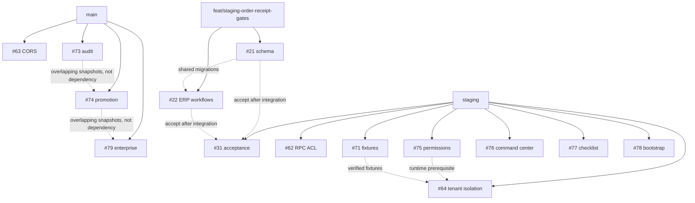

# D’Lice PR reconciliation — final report

**Snapshot:** 2026-11-17 UTC
**Decision:** **PHASE 2 PARTIAL — LOCAL CANDIDATES READY FOR INDEPENDENT REVIEW; EXTERNAL BLOCKERS REMAIN**

## A. Executive summary

- **14/14 PRs** had GitHub metadata/head SHA/checks reviewed; current base/head
  SHAs for the prioritized PRs were rechecked. Refreshed `main`:
  `8d74dbda81eb483a26d779b782fd4b37e12af770`; `staging`:
  `aed2733f62506ed87a5040a48f479753fdafe1b1`.
- **14 implementation/test commits** were created across nine isolated local
  PR worktrees. None was pushed, and no GitHub PR head changed. The original
  dirty checkout was preserved.
- **Five conflict paths across #79, #74, #73, and #62** were resolved in local
  candidates. The candidates are conflict-free against refreshed target refs;
  no merge or push was performed.
- **PRs requiring scope split: 2** (#79 and #73); #74 must be replaced with
  scoped production promotion changes rather than merged as a staging snapshot.
- **#62 candidate is based on current staging, while PR base remains stale**
  (`a021497…` versus current `aed2733…`). #64 still requires a fresh
  mergeability check because GitHub's `dirty` state disagreed with the exact
  local tree comparison.
- **Approvals observed: 0/14.** Some PRs have `COMMENTED` reviews; none has an
  approval decision at this snapshot.
- **Runtime/config blockers:** #71/#74 staging auth credentials, #64 tenant
  isolation acceptance, #78 disposable DB replay/Auth Admin verification, and
  general branch-protection/staging environment metadata access.
- **Proven superseded PRs: 0.** No branch was deleted, PR closed, migration run,
  or deployment performed.

The PR-by-PR evidence, SHAs, status checks, and migration paths are in
[PR_RECONCILIATION_MASTER.md](./PR_RECONCILIATION_MASTER.md). The proposed
dependency/order graph is in [PR_DEPENDENCY_GRAPH.md](./PR_DEPENDENCY_GRAPH.md).

## B. Status of the 14 PRs

| PR | Scope | Initial condition / outcome | CI at snapshot | Review | Dependency | Status | Remaining work |
|---|---|---|---|---|---|---|---|
| [#79](https://github.com/dlice8888/dlice-landing-page/pull/79) | Enterprise FnB OS integration | Remote head unchanged; local conflict candidate `617309b…`; five conflicts resolved locally | 8/8 on remote head; local focused contracts 18/18 | No approval | Main-targeted broad snapshot; overlaps #21/#22, #62, #75–#78 | `SPLIT_REQUIRED` | Domain ownership/acceptance boundaries are documented; map actual files/commits to them, create only non-overlapping child PRs, and run remote CI/migration review |
| [#74](https://github.com/dlice8888/dlice-landing-page/pull/74) | Staging → main promotion | Local conflict candidate `6bdb392…`; remote head unchanged | 3 pass, 1 fail on remote; local focused contracts pass | No approval | Staging source with many overlapping PR changes | `NOT_SAFE_TO_MERGE` | `auth-negative` still needs real credential configuration; never promote the staging snapshot directly |
| [#73](https://github.com/dlice8888/dlice-landing-page/pull/73) | Branch-cleanup/audit | Local conflict candidate `dbe63d7…`; remote head unchanged | 3/3 on remote; local focused contracts pass | No approval | Shares conflict paths with #74/#79 | `SPLIT_REQUIRED` | Prove unique commits and cleanup actions; preserve active branches; remote CI and scope split remain |
| [#75](https://github.com/dlice8888/dlice-landing-page/pull/75) | Tenant-scoped permissions | Local candidate `da6d0d0…`; original dirty checkout preserved | Focused contracts 5/5; quality/release contracts PASS; Deno not run | No approval | Tenant runtime acceptance requires trusted fixture setup | `READY_AFTER_FIXES` | Deno test unavailable; independent review and real staging acceptance remain; candidate not pushed |
| [#76](https://github.com/dlice8888/dlice-landing-page/pull/76) | Command-center summary | Local contract commit `d567bdf…`; PR remains Draft | Command-center contract 4/4 | Commented only | Independent staging PR; RPC is platform-owner-only | `DRAFT_HOLD` | SQL replay and live aggregation not run; independent review remains |
| [#77](https://github.com/dlice8888/dlice-landing-page/pull/77) | Atomic branch checklist | Existing remote head retained; checklist/RPC scope contracts reviewed | Checklist + KDS contracts 21/21 | Commented only | Independent staging PR; checklist behavior | `DRAFT_HOLD` | pgTAP replay and wrong-branch runtime probes remain blocked; independent review remains |
| [#78](https://github.com/dlice8888/dlice-landing-page/pull/78) | Atomic tenant bootstrap | Local test commit `e1fb0b9…`; no Auth metadata writes through SQL | Node contracts 10/10; pgTAP unavailable | Commented only | Needs authorized Auth Admin verification; gate stays closed | `DRAFT_HOLD` | Disposable DB replay not run; no staging/production Auth operation; independent review remains |
| [#71](https://github.com/dlice8888/dlice-landing-page/pull/71) | Staging tenant fixtures | Local workflow candidate `1641d90…`; remote head unchanged | Workflow contract 1/1; probe 0/9 executed, 9 BLOCKED, exit 2 | No approval | Runtime fixture prerequisite to #75/#64 acceptance | `DRAFT_HOLD` | `auth-negative` still lacks authorized credentials/identities; no fabricated fixtures |
| [#64](https://github.com/dlice8888/dlice-landing-page/pull/64) | Tenant-isolation inventory | Draft/HOLD; `runtime-gates` failed; no valid tenant JWTs | 3 pass, 1 fail on remote; no probes executed | Commented only | Requires #75 permission correctness and #71 real fixtures for acceptance | `DRAFT_HOLD` | Complete all tenant/RLS/RPC/service-role and transfer probes with two verified identities; no skips; independent review |
| [#62](https://github.com/dlice8888/dlice-landing-page/pull/62) | Trigger-only RPC ACL revocation | Local candidate `1f04c8e…`; PR base `a021497…` older than current staging | 2/2 on remote; both E2E scripts parse locally | Commented only | Shares ACL migration path with broad snapshots | `READY_AFTER_REBASE` | Rebase/refresh candidate, verify migration history, test direct-client denial and authorized server RPC, then review |
| [#63](https://github.com/dlice8888/dlice-landing-page/pull/63) | Production CORS fail-closed | Local candidate `b99950e…`; no remote change | Authorization/CORS contracts 3/3 | Commented only | CORS is not authentication/authorization | `READY_FOR_INDEPENDENT_REVIEW` | Independent review and ruleset verification; no production action by this run |
| [#31](https://github.com/dlice8888/dlice-landing-page/pull/31) | Staging workflow acceptance | Draft; old staging base; current checks pass | 5/5 pass | No approval | Acceptance should follow one integrated #21/#22 implementation | `DRAFT_HOLD` | Run trusted workflow on correct integrated staging SHA and validate business outcomes |
| [#22](https://github.com/dlice8888/dlice-landing-page/pull/22) | ERP workflows API/UI | No local code change; same base as #21; two exact migration duplicates verified | 4/4 on remote; no test files tracked | No approval | Shared schema migrations with #21 and #79 | `DRAFT_HOLD` | Choose a migration owner/stack; add and run concurrency, idempotency, rollback, authorization, and audit tests |
| [#21](https://github.com/dlice8888/dlice-landing-page/pull/21) | Order/fulfillment/finance foundation | No local code change; two shared migration blobs byte-identical across #22/#79 | 4/4 on remote; no test files tracked | No approval | Candidate schema foundation for #22, but not a declared Git stack | `DRAFT_HOLD` | Choose one owner and verify migration replay, lifecycle, and transaction invariants |

No PR is declared merge-ready. Passing checks do not replace required review,
ruleset verification, or runtime acceptance.

## C. Conflict resolution log

| PRs | Files | Cause | Resolution | Tests |
|---|---|---|---|---|
| #79, #74, #73 | `.github/workflows/procurement-requisition-contract.yml`; `.github/workflows/staging-kds-pos-stock-positive-e2e.yml`; `.github/workflows/staging-procurement-positive-e2e.yml`; `tests/staging/kds-pos-stock-positive.mjs`; `tests/staging/procurement-receiving-positive.mjs` | Five add/add conflicts reproduced in isolated worktrees. | **Resolved in local candidates only:** #79 `617309b9bd87fcb66498a01c0413116b72857a43`; #74 `6bdb392431cdc33778b22d6f5ba518dd21dcdef2`; #73 `dbe63d7bf9946ef519fedbdfd5c59565017fcdc6`. Kept stricter main-side confirmation, trusted refs, branch-manager, negative/checklist, payment, and cleanup contracts. No push/merge. | KDS/receiving tests 18/18 plus requisition contract PASS on #79; syntax, focused contracts, diff check PASS on all. No remote CI run for candidates. |
| #62 | Same five workflow/test files | PR base is `a021497…`, while current staging is `aed2733…`; target-side receiving test had malformed newline syntax. | **Resolved in local candidate only:** `1f04c8e72954fc373713a8366ad8a0b161882780`. Current-staging merge-tree is clean; syntax error fixed. No push/merge. | Both staging E2E scripts pass `node --check`; diff check PASS. Migration replay and ACL runtime assertions unavailable. |
| #64 | None from local exact-SHA tree comparison; GitHub API says `dirty` | GitHub/local mergeability disagreement | **Unresolved.** Refresh refs and repeat before rebase. | Not applicable |

## C.1 Local implementation commits and test evidence

| PR | Local candidate SHA | Implemented change | Local validation |
|---|---|---|---|
| #75 | `da6d0d0b6962189341adbe36b95b26a43934489b` | Ignore inactive memberships in permission resolution. | Focused permission/gate contracts 5/5; repository quality and staging release contracts PASS; Deno unavailable. |
| #63 | `b99950e645ef38ef43491520ef0869503e4fd789` | Preserve fail-closed CORS and block uncertified service-role actions behind closed release gates. | Authorization/CORS contracts 3/3 PASS. |
| #71 | `1641d90781da73f68f9b9eefb0d0032588902c81` | Remove manual runtime dispatch; trusted staging-push-only workflow. | Workflow contract 1/1 PASS; missing-input probe status is FAIL, 0/9 executed, 9 BLOCKED, exit 2. |
| #76 | `d567bdf77a5b9351f600c3d93c059f23d567c3b0` | Assert command-center access is platform-owner-only and branch IDs come from the server-authorized query. | Command-center contract 4/4 PASS; DB replay unavailable. |
| #77 | No code change; head `f8c66324c0545857c3c58b2b5a194b97b99eb879` | Existing checklist authorization and atomic mutation retained. | Checklist + KDS contracts 21/21 PASS; wrong-branch runtime tests blocked on real identities. |
| #78 | `0bfd58fc584d7407a62ca04015a37f763cbd6c7a` | Add local Auth Admin API fixtures in the temporary replay context; remove SQL writes to Auth metadata; test duplicate owner and audit-failure rollback. | Node contracts 10/10, fixture-script syntax and workflow YAML parse PASS; `supabase test db` NOT RUN because Supabase CLI/PostgreSQL are unavailable. |
| #21 / #22 | No changes; heads `3cb0089f3c673e522dc9f0c688bd38d6d7b9f690` / `acfe37ead0125a94a1e918e529c76615cf2b4adc` | Reverified the two overlapping migration blobs match; no duplicate implementation was edited. | No tests tracked on either head; ERP lifecycle/concurrency/idempotency/rollback/auth acceptance remains incomplete. |
| #31 | No code change; head `6adce27672d3f9e73c376234934e8a4d30992907` | Existing workflow retained. | Acceptance script syntax PASS; no staging run. |

All local candidates remain unpushed. No CI run URL exists for them; the remote
run URLs below refer to the unchanged GitHub heads.

## D. Migration reconciliation

- The 14 PR file sets contain **50 distinct migration paths**.
- #79/#74/#73 share **45 paths**; their large diff overlap is not three
  independent migration sets.
- #21/#22 share
  `20261020194817_order_fulfillment_production_finance_controls.sql` and
  `20261020195004_atomic_purchase_receiving_and_production_consumption.sql`.
  Their exact blobs match between #21, #22, and #79. All 11 migration blobs in
  #22 were byte-identical to #79 at the queried heads.
- #62's `20261027140145_revoke_client_execute_on_trigger_only_functions.sql`
  also appears in #79/#74/#73. The PR description says it was already applied
  to staging; this run could not independently verify migration history.
- The five later distinct migrations belong to #64, #71, #76, #77, and #78.
- No local Supabase CLI/PostgreSQL tooling was available. No disposable replay
  ran and no staging/production migration was applied. Exact path inventory is
  in the master document.

## E. Dependency graph

Solid arrows are actual PR bases. Dotted arrows are validation sequencing or
observed overlap, not declared GitHub stacking. See
[PR_DEPENDENCY_GRAPH.md](./PR_DEPENDENCY_GRAPH.md) for full base SHA detail,
branch dispositions, and proposed work order.

## F. Security findings

| # | Severity | File | Lines | Vulnerability | Confidence |
|---|----------|------|-------|---------------|------------|
| 1 | 🟠 HIGH | `supabase/functions/dlice-orders/index.ts` | 38-41, 178-180 | Service-role order handlers lacked verified permission and tenant/branch scope; local candidate now blocks uncertified actions behind the closed tenant gate. | 9/10 |
| 2 | 🟡 MEDIUM | `.github/workflows/staging-runtime-tenant-isolation.yml` | 4-6, 21-23 | Manual runtime workflow could execute a selected ref with staging credentials; local candidate restricts the job to trusted pushes on `staging`. | 8/10 |

- **Tenant release gates:** the checked-out source still has
  `TENANT_ISOLATION_RELEASED=false` and `PUBLIC_TENANT_ROUTING_RELEASED=false`.
  Preserve both. #64 remains Draft/HOLD.
- **Tenant authorization:** isolated #75 candidate `da6d0d0…` filters
  permissions through active memberships. Focused Node authorization/gate
  contracts pass; this candidate is not the current remote #75 head. The Deno
  unit test was not run because Deno is unavailable.
- **Runtime tenant acceptance:** #71's auth-negative check and #64's
  runtime-gates check failed on their current heads. No trusted Tenant A/B
  identity, branch ownership, or cross-tenant read/write acceptance was
  independently verified. The #71 local probe explicitly reports `FAIL` with
  zero executed probes and nine blocked probes when credentials are absent.
- **Fixture name contract:** current workflow/runtime code expects
  `STAGING_TENANT_A_BRANCH_ID` / `STAGING_TENANT_B_BRANCH_ID` and
  `STAGING_TENANT_A_USER_ID` / `STAGING_TENANT_B_USER_ID`. The request lists
  `STAGING_BRANCH_A_ID` / `STAGING_BRANCH_B_ID` and
  `STAGING_USER_A_ID` / `STAGING_USER_B_ID`. Environment metadata is inaccessible
  (403), so no rename or assumption was made; an authorized maintainer must
  select and configure one canonical contract before runtime acceptance.
- **RPC ACL:** #62 local candidate `1f04c8e…` resolves the five conflicts
  against current staging and repairs a syntax error in the receiving E2E file.
  Its two remote checks passed, but direct-client RPC denial, authorized server
  path, and the PR description's staging migration claim were not independently
  verified.
- **CORS/service role:** #63 local candidate `b99950e…` keeps exact-origin
  fail-closed CORS and closes uncertified service-role actions behind closed
  gates. Contracts pass 3/3; no production endpoint was probed or changed.
- **Owner authorization:** #78 local candidate `0bfd58f…` removes SQL writes to
  Auth metadata from pgTAP setup and provisions disposable Auth users through
  local Auth Admin. No Auth Admin operation or allowlist update occurred in
  staging/production; pgTAP replay remains blocked.
- **Branch authorization/audit trail:** static local contracts passed, but
  staging runtime branch-boundary and audit-actor acceptance remains unrun.

## G. CI/CD findings

GitHub check summaries for the current PR heads:

| PR | Result | Evidence |
|---|---|---|
| #79 | PASS, 8/8 | Current head `8f31f6d201e7bcda0041dfcda8e6123a42b6ba14` |
| #74 | FAIL, 3 pass / 1 fail | `auth-negative`, [run 43434328863](https://github.com/dlice8888/dlice-landing-page/actions/runs/43434328863), head `aed2733f62506ed87a5040a48f479753fdafe1b1` |
| #73 | PASS, 3/3 | Current head `48f43c12a3095a423a4f90cc19ca05a9675880ef` |
| #75 | PASS, 8/8 | Current remote head `79f785711f70af51926bca07f7f4cfddbb0f6179` |
| #76 | PASS, 9/9 | Current head `1158cb54ccd1a7d755df7beba42ebe3f7ff82127` |
| #77 | PASS, 9/9 | Current head `f8c66324c0545857c3c58b2b5a194b97b99eb879` |
| #78 | PASS, 9/9 | Current head `8fa13f3700bd3bb148644733beeff01fbb5d271f` |
| #71 | FAIL, 10 pass / 1 fail | `auth-negative`, [run 42423209284](https://github.com/dlice8888/dlice-landing-page/actions/runs/42423209284), head `60fb9b90be68564a8975c4aee40d4a03adddb1c6` |
| #64 | FAIL, 3 pass / 1 fail | `runtime-gates`, [run 42094053543](https://github.com/dlice8888/dlice-landing-page/actions/runs/42094053543), head `86b19faeb354cca0e3d9a6f45e6d059376126b6c` |
| #62 | PASS, 2/2 | Current head `4329dc32d72262757eead4d26e5c3d2a2052d7eb` |
| #63 | PASS, 2/2 | Current head `9115ec20c8ed9936f9a30898435963fd6021bcdf` |
| #31 | PASS, 5/5 | Current head `6adce27672d3f9e73c376234934e8a4d30992907` |
| #22 | PASS, 4/4 | Current head `acfe37ead0125a94a1e918e529c76615cf2b4adc` |
| #21 | PASS, 4/4 | Current head `3cb0089f3c673e522dc9f0c688bd38d6d7b9f690` |

Repository quality checks and staging contract checks passed locally, and the
focused Node security contracts passed on the isolated candidates. These are not
staging E2E or migration replay. #74 and #71 `auth-negative` are configuration/
credential blockers: `STAGING_TEST_BRANCH_A_USERNAME` is unavailable and the
preflight exits blocked rather than passing. #64 `runtime-gates` is blocked
because Tenant A/B JWTs are unavailable; zero probes executed, so isolation is
not certified. No new run URL exists for the local candidates because they were
not pushed. Required check definitions and branch
protections could not be inspected: GitHub returned 403 for `main` and
`staging` protection endpoints. Staging environment secret/variable metadata
also returned 403. No workflow was manually dispatched.

## H. External administrator actions

1. **Repository rules:** authorized administrator to verify required reviewers,
   required checks, and protection rules for `main`/`staging`; do not weaken or
   remove any gate.
2. **Staging environment:** authorized environment administrator to verify
   required secret/variable names and provision them privately. Do not paste
   credentials in chat.
3. **Fixture proof:** Supabase administrator to verify actual distinct tenants,
   branches, users, active memberships, and branch assignments with read-only
   queries or approved Auth paths. No UUID fixtures should be invented.
4. **Canonical variable names:** maintainer to reconcile the workflow's
   `STAGING_TENANT_A_BRANCH_ID` / `_USER_ID` names with the request's
   `STAGING_BRANCH_A_ID` / `STAGING_USER_A_ID` names before provisioning.
5. **Owner bootstrap:** authorized Auth Admin to verify trusted
   `app_metadata.platform_owner=true` and the matching server allowlist using
   approved mechanisms; no direct SQL metadata update.
6. **Migration state:** authorized operator to verify applied migration
   history, especially #62, without applying migrations as part of this task.
7. **Staging acceptance:** authorized maintainer to run the trusted staging
   workflows after code review and fixture verification; do not dispatch
   production jobs.

## I. Recommended merge/review sequence

No merge is authorized by this report.

1. Preserve and reconcile the existing dirty local checkout; refresh PR refs.
2. Review #63 independently and verify its actual CORS handler contract.
3. Reconcile #75's current remote code with the existing local active-membership
   delta; run Deno tests in a provisioned environment; obtain independent review.
4. Resolve #62's five workflow/test conflicts, then verify migration history and
   rebase.
5. Review #76/#77 independently and reproduce DB replay tests in a disposable
   database. Keep #78 held until Owner authorization and rollback tests pass.
6. Fix #71's failed authenticated workflow only after an administrator proves
   the real staging fixtures; then run the trusted staging acceptance.
7. Keep #64 Draft/HOLD until complete two-tenant read/write isolation, RLS,
   service-role/RPC, transfer denial, and audit evidence passes with no skips.
8. Reconcile #21/#22 shared migrations under one owner; rebase/stack the API
   work and run #31 acceptance after integration.
9. Split #79 into bounded reviewable PRs and determine which exact changes from
   #73 are cleanup versus integration. Preserve all active branches.
10. Do not merge #74 directly. Promote only individually reviewed and
    production-approved changes after required checks and migration review.

For every PR, required reviewers/checks remain an administrator-controlled
prerequisite that could not be verified from this integration.

## J. Final decision

**PHASE 2 PARTIAL — LOCAL CANDIDATES READY FOR INDEPENDENT REVIEW; EXTERNAL BLOCKERS REMAIN.**

All 14 requested PRs have current metadata/check evidence and a provisional
status. Five conflict paths have local candidate resolutions; scoped security
and test changes are committed in isolated worktrees. GitHub PR heads remain
unchanged. Deno tests, migration replay, trusted staging tenant acceptance,
authorized migration-history verification, branch-protection review, ERP
concurrency/rollback/authorization coverage, and the full 18-domain #79 split
remain incomplete. Both tenant release flags remain false; PR #64 remains
Draft/HOLD. No PR was merged or closed, no branch was deleted, and no
staging/production migration or deployment occurred.
