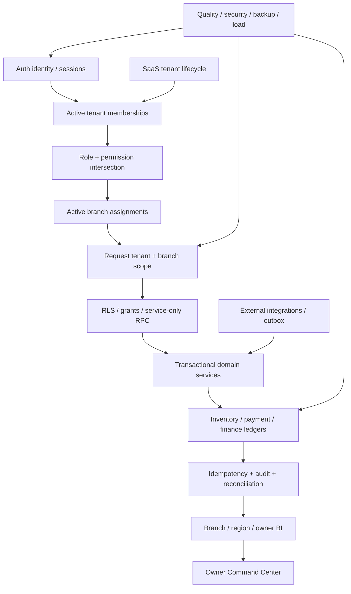

# FnB OS Architecture & Dependency Map

**Snapshot:** 18 November 2026  
**Target:** staging only

## Dependency graph

## Critical dependency order

1. Auth identity and session validity.
2. Active tenant membership and non-privileged role validation.
3. Permission intersection across active memberships; global admin profile permissions are not tenant grants.
4. Active branch assignment and exact tenant/branch relation.
5. Edge Function action authorization and explicit tenant context.
6. RLS and service-role-only RPC boundaries.
7. Atomic domain transitions, idempotency and audit events.
8. Inventory/payment/finance ledgers and transaction reconciliation.
9. Branch → region → group reporting and Owner dashboard.
10. External provider delivery, backups, monitoring, load and rollout.

## Current architecture evidence

- `supabase/functions/dlice-orders/index.ts:52-55`: both tenant and public tenant routing release flags are hard-coded false in staging source.
- `supabase/functions/dlice-orders/index.ts:92-100`: Owner bypass requires profile role `owner`, UUID allowlist membership, and Auth `app_metadata.platform_owner === true`.
- `supabase/functions/dlice-orders/tenant-permissions.ts`: active membership permissions are intersected; wildcard membership does not widen a narrower membership.
- Staging database: 64 public tables with RLS, 64 policies, 29 public functions, 5 SECURITY DEFINER functions.
- The five SECURITY DEFINER stock functions are service_role executable and denied to anon/authenticated in current privilege inventory.
- Direct public table grants to anon/authenticated are limited to SELECT on `public.products`.
- 155 branch rows are present, but this is not evidence of 150 configured operational branches or production readiness.
- Current worker A/B permissions are equivalent, but Worker A has two active same-tenant assignments; the canonical P03 test expects exactly one branch.

## PR dependency graph

- #71 canonical trusted fixtures → #75 permission runtime assumptions → #64 tenant isolation HOLD.
- #78 atomic tenant bootstrap depends on Owner authorization and disposable database rollback/replay evidence.
- #77 checklist atomicity depends on branch/tenant scope and migration replay.
- #76 Command Center depends on Owner-only authorization and trusted branch aggregation.
- #21/#22 share migration ownership; #22 also overlaps the broad #79 integration history. Select one migration source owner before schema promotion.
- #31 is a downstream workflow acceptance gate, not a substitute for business-path E2E.
- #74 is a broad staging-to-main promotion and is not a safe substitute for bounded production release PRs.

## Inventory read path correction candidate

The deployed v69 handler's global denylist blocked `erp-list-inventory` before its branch authorization helper. PR #85 is a bounded candidate that removes only that action from the denylist, requires `inventory` permission and explicit branch_id, verifies active membership and exact active branch assignment before querying, then reads `branch_inventory` joined to `inventory_items`. It intentionally keeps global inventory master writes denied because `inventory_items` has no tenant_id ownership column. Candidate CI passed; no staging deployment or P04/P06 runtime proof yet.

## Main architecture risks

- Tenant context is not yet proven end-to-end across every action, RPC, view, storage object, scheduled task and integration event.
- Shared Edge Function has legacy action handlers; `TENANT_SCOPE_UNCERTIFIED_ACTIONS` deliberately fails closed for unverified actions.
- Five SECURITY DEFINER functions require ongoing function-body and EXECUTE-grant review even though client EXECUTE is currently denied.
- Ledger correctness, rollback and idempotency must be tested across cross-module transactions before Owner BI can be trusted.

## Identity classification dependency

A staging read-only query found the only allowed global profile roles are `sales_admin` and `owner`, while tenant membership roles include `branch_manager`. The two candidate workers have `sales_admin` global profile role, so the system currently conflates admin profile classification with ordinary worker identity. PR #86 proposes a distinct `branch_worker` identity classification while keeping tenant authorization exclusively membership/assignment based. This role migration and Owner-authorized conversion must precede P03 certification.
